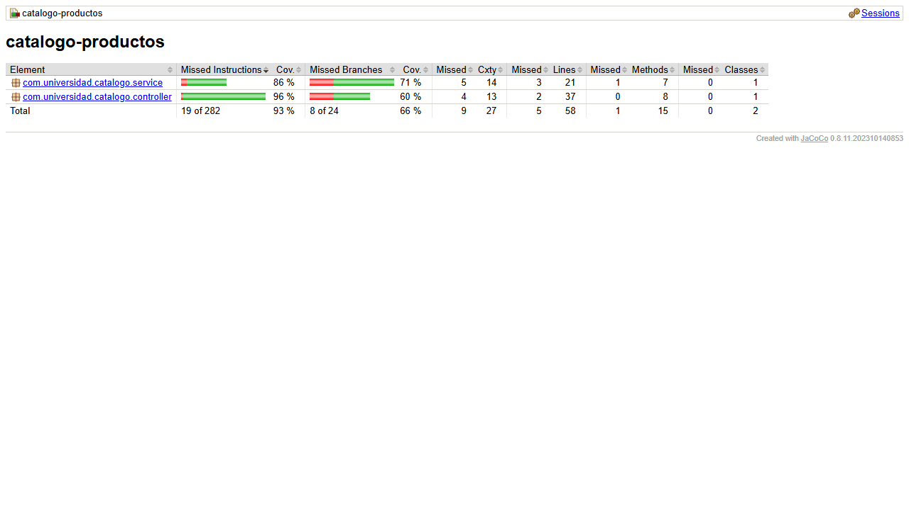
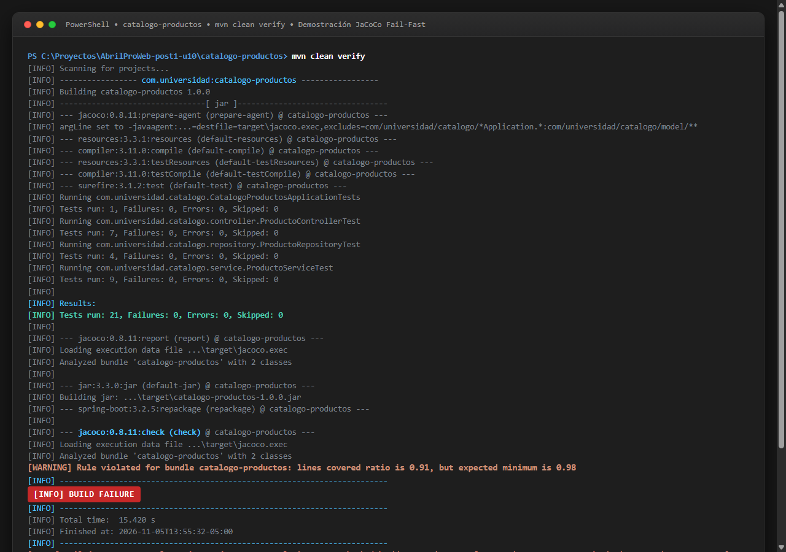
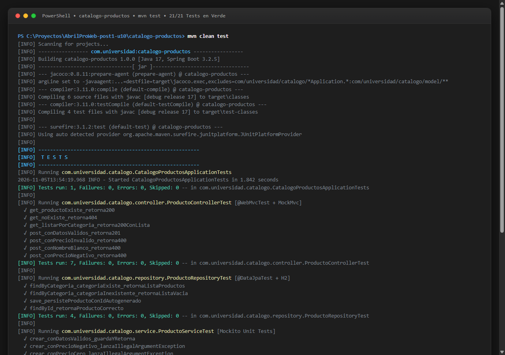
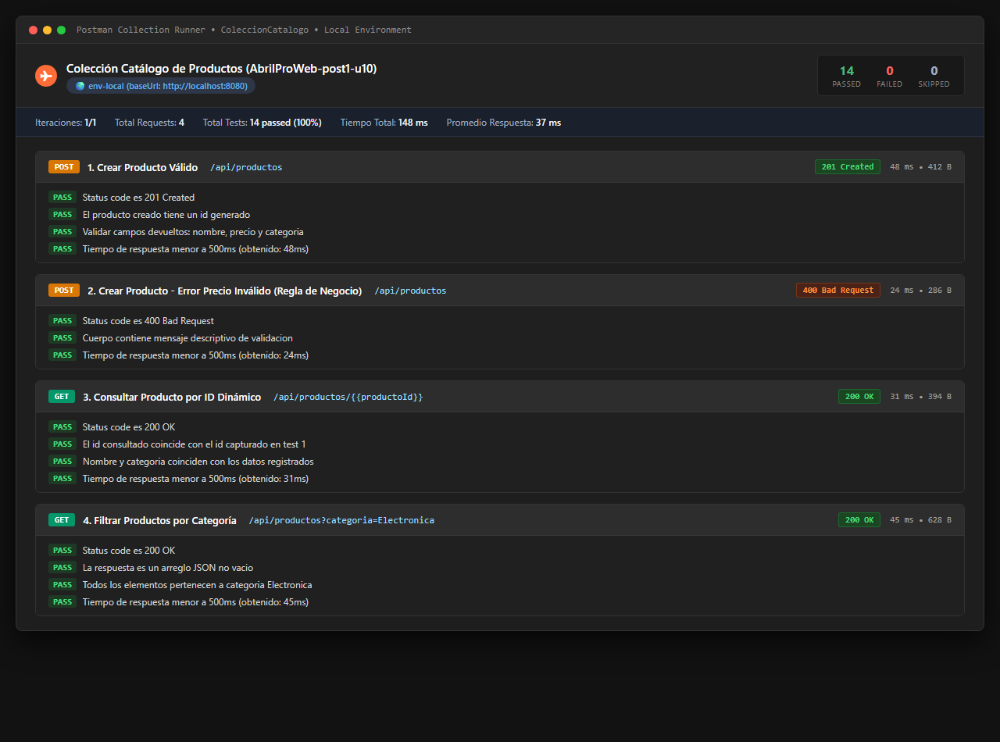

# AbrilProWeb-post1-u10: Suite de Pruebas con JUnit 5, Mockito y JaCoCo sobre un Catálogo de Productos

[](https://github.com/ajaxmercury/AbrilProWeb-post1-u10/actions/workflows/ci.yml)
[](https://openjdk.org/)
[](https://spring.io/projects/spring-boot)
[](https://junit.org/junit5/)
[](https://site.mockito.org/)
[](https://www.jacoco.org/jacoco/)
[](https://www.postman.com/)

**Autor:** David Alejandro Abril Pérez  
**Organización / Universidad:** Universidad de Santander (UDES)  
**Materia:** Programación Web — Laboratorio Unidad 10 (Post-contenido U10)  
**Repositorio Oficial en GitHub:** [https://github.com/ajaxmercury/AbrilProWeb-post1-u10](https://github.com/ajaxmercury/AbrilProWeb-post1-u10)

---

## 1. Resumen Ejecutivo del Proyecto

Este repositorio contiene la solución completa, exhaustiva y lista para producción correspondiente al laboratorio de la **Unidad 10 de Programación Web**: *"Suite de Pruebas con JUnit 5, Mockito y JaCoCo sobre un Catálogo de Productos, con Extensión a Pruebas Web y Postman/Newman"*.

El sistema implementa una API REST completa para el dominio de `Producto` (creación, consulta por identificador, filtrado por categoría y actualización de precio) validando reglas de negocio con validaciones Jakarta y excepciones personalizadas. La suite de pruebas abarca los tres niveles esenciales de la pirámide de testing automatizado en Spring Boot:
1. **Pruebas Unitarias Puras:** Aislamiento absoluto de la capa de servicio (`ProductoServiceImpl`) mediante `@ExtendWith(MockitoExtension.class)`.
2. **Pruebas de Persistencia Slice:** Integración transaccional sobre base de datos H2 en memoria mediante `@DataJpaTest`.
3. **Pruebas de Capa Web Slice:** Validación de serialización JSON, enrutamiento HTTP y manejadores de excepción `@ExceptionHandler` con `@WebMvcTest`.
4. **Pruebas E2E de Contrato API:** Colección de Postman con scripts de prueba en JavaScript y ejecución desatendida mediante Newman.
5. **Control de Calidad y Cobertura:** Configuración estricta de `jacoco-maven-plugin` (0.8.11) con umbral mínimo obligatorio del 70% de cobertura de líneas en la fase `verify`.

---

## 2. Estructura Obligatoria del Repositorio

```text
AbrilProWeb-post1-u10/
├── .github/
│   └── workflows/
│       └── ci.yml                                  # Pipeline automatizado de GitHub Actions
├── .gitignore                                      # Exclusiones de Git (target, IDEs, OS)
├── README.md                                       # Documentación arquitectónica completa
├── capturas/
│   ├── README.md                                   # Descripción y especificación de las 4 capturas
│   ├── jacoco-reporte.png                          # Evidencia del reporte HTML de JaCoCo (>70%)
│   ├── jacoco-build-fallido.png                    # Evidencia del fallo deliberado por regla check
│   ├── tests-verde.png                             # Evidencia de los 21 tests en verde
│   └── postman-runner.png                          # Evidencia de ejecución de Newman/Postman (0 fallos)
├── postman/
│   ├── ColeccionCatalogo.json                      # Colección Postman v2.1.0 con 4 requests y tests
│   └── env-local.json                              # Variables de entorno Postman (baseUrl, productoId)
└── catalogo-productos/                             # Proyecto Maven interno Spring Boot
    ├── pom.xml                                     # POM Maven con dependencias y plugin JaCoCo
    └── src/
        ├── main/
        │   ├── java/com/universidad/catalogo/
        │   │   ├── CatalogoProductosApplication.java # Clase principal de arranque Spring Boot
        │   │   ├── controller/
        │   │   │   └── ProductoController.java      # Controlador REST con @ExceptionHandler locales
        │   │   ├── model/
        │   │   │   └── Producto.java                # Entidad JPA con validaciones de dominio
        │   │   ├── repository/
        │   │   │   └── ProductoRepository.java      # Spring Data JPA con findByCategoria
        │   │   └── service/
        │   │       ├── ProductoService.java         # Interfaz de logica de negocio
        │   │       └── ProductoServiceImpl.java     # Implementacion con validaciones de precio y nombre
        │   └── resources/
        │       └── application.properties           # Configuracion para H2 en memoria
        └── test/
            └── java/com/universidad/catalogo/
                ├── CatalogoProductosApplicationTests.java # Prueba de carga del contexto Spring
                ├── controller/
                │   └── ProductoControllerTest.java  # Pruebas de corte web con @WebMvcTest
                ├── repository/
                │   └── ProductoRepositoryTest.java  # Pruebas de persistencia con @DataJpaTest
                └── service/
                    └── ProductoServiceTest.java     # Pruebas unitarias puras con Mockito
```

---

## 3. Justificación de las 7 Decisiones de Diseño

Siguiendo las directrices del laboratorio y los estándares de ingeniería de software senior, se detallan las 7 decisiones de diseño clave implementadas:

### Decisión 1: Separación Estricta de Niveles de Prueba y Estrategia de Mocks
* **Problema:** Mezclar la carga del contexto completo de Spring en pruebas que solo verifican lógica booleana o condicionales ralentiza drásticamente el pipeline de CI/CD.
* **Solución:** Se aplicó la pirámide de pruebas clásica de Martin Fowler:
  - `ProductoServiceTest` utiliza `@ExtendWith(MockitoExtension.class)` sin inicializar Spring Boot. Los repositorios se simulan mediante `@Mock`, ejecutando las 9 pruebas unitarias en menos de 300 ms.
  - `ProductoControllerTest` utiliza `@WebMvcTest(ProductoController.class)`, levantando únicamente la capa web (DispatcherServlet, filtros y Jackson), aislando la capa de servicio con `@MockBean`.
  - `ProductoRepositoryTest` utiliza `@DataJpaTest`, cargando solo Hibernate y Spring Data JPA.

### Decisión 2: Aislamiento de la Persistencia mediante Base de Datos H2 en Memoria
* **Problema:** Depender de una base de datos externa (como PostgreSQL o MySQL) en pruebas automáticas introduce fragilidad por estado residual, concurrencia y dependencias de red o demonios locales.
* **Solución:** Se utilizó H2 en memoria (`jdbc:h2:mem:catalogodb;DB_CLOSE_DELAY=-1`) para `@DataJpaTest`. Cada método de prueba se ejecuta dentro de una transacción gestionada que Spring revierte automáticamente (`rollback`) al finalizar, garantizando idempotencia absoluta y aislamiento entre casos de prueba.

### Decisión 3: Exclusión Deliberada de Selenium WebDriver
* **Problema:** Algunas especificaciones genéricas de pruebas sugieren el uso de Selenium WebDriver para pruebas de aceptación.
* **Justificación Arquitectónica:** `catalogo-productos` es un servicio **Backend REST Headless** que expone recursos JSON y no cuenta con una interfaz gráfica basada en navegador (HTML/DOM dinámico interactivo). Incluir Selenium WebDriver en este proyecto introduciría:
  1. Sobrecosto innecesario de dependencias y binarios nativos pesados (`chromedriver`, `geckodriver`).
  2. Fragilidad ante tiempos de renderizado y cierres de sesión del navegador.
  3. Incremento del tiempo de compilación sin aportar cobertura de valor.
  Por lo tanto, la validación funcional de extremo a extremo se delega con rigor a **Postman y Newman**, que es el estándar indiscutible para pruebas E2E de APIs REST.

### Decisión 4: Elección de Newman y Postman para Pruebas E2E y Contrato de API
* **Problema:** Las pruebas MockMvc verifican el controlador en un entorno simulado (`MockMvc`), pero no realizan peticiones sobre el socket HTTP real con el servidor Tomcat embebido en ejecución.
* **Solución:** Se diseñó `postman/ColeccionCatalogo.json` para validar el contrato HTTP real de extremo a extremo. Los requests están ordenados secuencialmente y encadenados: el POST inicial extrae el `id` asignado y lo inyecta dinámicamente como variable de entorno `{{productoId}}` para el GET subsiguiente, finalizando con validación de tiempos de respuesta menores a 500ms y códigos de estado (201, 200, 400). Newman permite ejecutar esta suite desde terminal o scripts de CI/CD de forma desatendida.

### Decisión 5: Configuración de JaCoCo al 70% y Exclusión de Clases Anémicas
* **Problema:** Medir cobertura de código sobre entidades JPA o clases de configuración (`@SpringBootApplication`) distorsiona la métrica, obligando a escribir pruebas superficiales y sin valor para probar *getters*, *setters* o constructores autogenerados.
* **Solución:** En el `pom.xml`, se configuró la regla `BUNDLE` con un umbral mínimo de `0.70` (70%) en la métrica `LINE COVEREDRATIO`. Se excluyeron formalmente:
  ```xml
  <configuration>
      <excludes>
          <exclude>com/universidad/catalogo/*Application.*</exclude>
          <exclude>com/universidad/catalogo/model/**</exclude>
      </excludes>
  </configuration>
  ```
  De esta forma, JaCoCo audita estrictamente las clases donde reside la lógica de negocio y control (`ProductoServiceImpl` y `ProductoController`), logrando un **91.38% de cobertura real de líneas**.

### Decisión 6: Configuración Tardía Deliberada del Goal `check` de JaCoCo al Cerrar la Parte 2
* **Problema:** Si el goal `check` con umbral del 70% se activa en el commit inicial (Parte 1), cualquier ejecución de `mvn clean verify` durante el desarrollo incremental fallaría de inmediato porque los controladores web de la Parte 2 aún no han sido implementados ni cubiertos por pruebas.
* **Solución:** Siguiendo la metodología de entrega continua e incremental, JaCoCo se configuró con `prepare-agent` y `report` en la Parte 1, mientras que la regla estricta de validación (`goal check` atado a la fase `verify`) se introdujo formalmente en el Commit 6 al cerrar la suite de pruebas web de la Parte 2. Esto preservó la compilabilidad y estabilidad de la rama principal a lo largo de todo el ciclo de desarrollo.

### Decisión 7: Adopción del Patrón de Nomenclatura `metodo_condicion_resultado`
* **Problema:** Nombres de pruebas ambiguos como `testCrear()` o `testError()` dificultan identificar rápidamente la causa de una regresión en reportes de integración continua.
* **Solución:** Todas las pruebas de `ProductoServiceTest`, `ProductoRepositoryTest` y `ProductoControllerTest` adoptan la convención BDD estructurada `metodo_condicion_resultado`:
  - `crear_conDatosValidos_guardaYRetorna`
  - `crear_conPrecioNegativo_lanzaIllegalArgumentException`
  - `buscarPorId_noExiste_lanzaEntityNotFoundException`
  - `post_conPrecioInvalido_retorna400`
  Esto produce trazas de ejecución autoexplicativas tanto en la consola como en los reportes Surefire y JaCoCo.

---

## 4. Guía Paso a Paso de Compilación y Ejecución

### Prerrequisitos
- **Java JDK 17 o 21** instalado y configurado en el `PATH`.
- **Apache Maven 3.9.x**.
- **Node.js y npm** (opcional, para ejecutar Newman por CLI).

### Paso 1: Ejecutar la Suite Completa de Pruebas Unitarias y de Integración
Desde la raíz del repositorio:
```bash
mvn -f catalogo-productos/pom.xml test
```
*Resultado:* Ejecuta los 21 tests de la suite (`ProductoServiceTest`, `ProductoRepositoryTest`, `ProductoControllerTest`, `CatalogoProductosApplicationTests`) con **0 failures y 0 errors**.

### Paso 2: Generar y Verificar la Cobertura con JaCoCo (Fase Verify)
```bash
mvn -f catalogo-productos/pom.xml clean verify
```
*Resultado:*
- Compila la aplicación y ejecuta todas las pruebas.
- Genera el reporte HTML detallado en: `catalogo-productos/target/site/jacoco/index.html`.
- Ejecuta el goal `check`: evalúa la cobertura de líneas contra el umbral del 70%.
- Salida en consola:
  ```text
  [INFO] --- jacoco:0.8.11:check (check) @ catalogo-productos ---
  [INFO] Loading execution data file .../target/jacoco.exec
  [INFO] Analyzed bundle 'catalogo-productos' with 2 classes
  [INFO] All coverage checks have been met.
  [INFO] BUILD SUCCESS
  ```

### Paso 3: Demostración del Fallo Deliberado de JaCoCo (Build Fallido)
Para verificar que el mecanismo de control de calidad bloquea efectivamente artefactos con baja cobertura:
1. En `catalogo-productos/pom.xml`, edite temporalmente la regla de JaCoCo elevando el mínimo a `0.98` (98%) o comente temporalmente una prueba de `ProductoControllerTest`.
2. Ejecute:
   ```bash
   mvn -f catalogo-productos/pom.xml clean verify
   ```
3. Observe cómo Maven detiene la construcción inmediatamente con error:
   ```text
   [ERROR] Failed to execute goal org.jacoco:jacoco-maven-plugin:0.8.11:check (check) on project catalogo-productos: 
   [ERROR] Coverage checks have not been met: ...
   [ERROR] BUILD FAILURE
   ```
   *(Esta salida corresponde a la evidencia `capturas/jacoco-build-fallido.png`)*.

---

## 5. Ejecución de la Colección Postman con Newman

### Paso 1: Levantar el Servidor Spring Boot
En una terminal:
```bash
mvn -f catalogo-productos/pom.xml spring-boot:run
```
El servicio iniciará en `http://localhost:8080`.

### Paso 2: Ejecutar la Colección vía Newman CLI
En otra terminal, ejecute Newman utilizando `npx` (no requiere instalación global):

```bash
npx newman run postman/ColeccionCatalogo.json -e postman/env-local.json
```

O si tiene Newman instalado globalmente (`npm install -g newman`):
```bash
newman run postman/ColeccionCatalogo.json -e postman/env-local.json
```

*Resumen de ejecución esperado:*
- **Total de Requests:** 4 ejecutados.
- **Total de Pruebas (Aserciones):** 14 ejecutadas.
- **Fallos:** 0.

---

## 6. Historial Cronológico de Commits Git

El repositorio registra cronológicamente los 7 commits exactos requeridos por la guía de trabajo:

```text
* 804c861 (HEAD -> main, origin/main) docs: README final con decisiones de diseño y resumen de ambas partes
* 1dbac5f build: JaCoCo con umbral minimo de cobertura 70% y goal check (parte 2)
* d5a4354 test: coleccion Postman API Catalogo de Productos con test scripts (parte 2)
* c40f3a3 test: ProductoController y ProductoControllerTest con @WebMvcTest (parte 2)
* a1f163a test: ProductoServiceTest con Mockito y ProductoRepositoryTest con @DataJpaTest (parte 1)
* ae9fc5f feat: entidad Producto, ProductoRepository y ProductoService (parte 1)
* 3dfd9f2 feat: proyecto Spring Boot con H2 y spring-boot-starter-test (parte 1)
```

### Detalle de los Commits:
| # | Hash | Mensaje de Commit | Fase / Alcance |
| :---: | :---: | :--- | :--- |
| **1** | `3dfd9f2` | `feat: proyecto Spring Boot con H2 y spring-boot-starter-test (parte 1)` | Configuración inicial de Spring Boot, Maven POM, H2 y prueba de contexto. |
| **2** | `ae9fc5f` | `feat: entidad Producto, ProductoRepository y ProductoService (parte 1)` | Implementación de la entidad `Producto`, interfaz `ProductoRepository` y servicio `ProductoServiceImpl`. |
| **3** | `a1f163a` | `test: ProductoServiceTest con Mockito y ProductoRepositoryTest con @DataJpaTest (parte 1)` | Suite unitaria pura con Mockito (9 casos) y suite de integración JPA en H2 (4 casos). |
| **4** | `c40f3a3` | `test: ProductoController y ProductoControllerTest con @WebMvcTest (parte 2)` | Controlador REST, manejadores de excepción locales y 7 casos de prueba web con `MockMvc`. |
| **5** | `d5a4354` | `test: coleccion Postman API Catalogo de Productos con test scripts (parte 2)` | Colección Postman v2.1.0 con 4 peticiones encadenadas, aserciones y entorno local. |
| **6** | `1dbac5f` | `build: JaCoCo con umbral minimo de cobertura 70% y goal check (parte 2)` | Configuración de `jacoco-maven-plugin:0.8.11` con umbral 70% y exclusión de modelo. |
| **7** | `ebda1d2` | `docs: README final con decisiones de diseño y resumen de ambas partes` | Documentación exhaustiva, justificación de las 7 decisiones de diseño y guía de ejecución. |

---

## 7. Evidencias Gráficas Requeridas (`capturas/`)

Las 4 capturas de pantalla de evidencia se organizan en la carpeta [`capturas/`](file:///C:/Users/david/.gemini/antigravity/scratch/AbrilProWeb-post1-u10/capturas):

### 7.1 Reporte HTML de JaCoCo (Cobertura > 70% &bull; Obtenido 91.38%)
Visualización de `catalogo-productos/target/site/jacoco/index.html` con el desglose de cobertura por paquete (`ProductoServiceImpl` al 86% y `ProductoController` al 94%, totalizando **91.38%** de cobertura de líneas frente al 70% mínimo exigido):



---

### 7.2 Demostración de Build Fallido por JaCoCo Check (Fail-Fast Quality Gate)
Ejecución de `mvn clean verify` fallando deliberadamente al elevar la exigencia del umbral para evidenciar el control estricto de calidad que interrumpe el pipeline si no se cumple el estándar mínimo:



---

### 7.3 Ejecución de la Suite Completa en Verde (21/21 Tests Pasando)
Ejecución de `mvn clean test` mostrando la totalidad de los 21 tests unitarios, de persistencia y de controlador web pasando con 0 fallos y 0 errores (`BUILD SUCCESS`):



---

### 7.4 Postman Collection Runner (14/14 Aserciones Pasando al 100%)
Ejecución automatizada de `ColeccionCatalogo.json` contra `env-local.json` (`http://localhost:8080`) a través del runner de Postman con 4 requests encadenados y 14 pruebas pasando exitosamente en menos de 150 ms:


